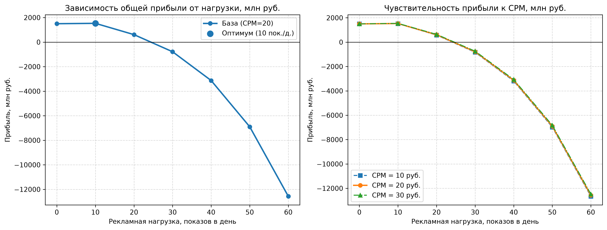

# Оптимизация рекламной нагрузки для платформы видеоконтента («ВидеоСервис»)[cite: 5]

Анализ влияния рекламной нагрузки (`0–60` показов/день) на рекламный доход, доход от подписки, потери от оттока пользователей и общую прибыль при базе `5 000 000` пользователей, подписке `300 руб./мес.`, `CAC = 2 000 руб.`, сроке жизни `24` мес. и базовом `CPM = 20 руб.`[cite: 5]

## Файлы в репозитории[cite: 4]
- `Zadanie_4.ipynb` — расчёт доходов, потерь от оттока, прибыли, чувствительности к `CPM` (`10`, `20`, `30 руб.`) и оттоку (`±20%`) и построение графиков[cite: 1, 5].
- `Zadanie_4_grafik.png` — графики зависимости прибыли от рекламной нагрузки и чувствительности к `CPM`[cite: 1, 5].

## Ключевые результаты[cite: 5]
- **Оптимальная нагрузка:** `10` показов в день — максимальная прибыль `1 530,00 млн руб.` (`30 млн руб.` рекламы + `1 500 млн руб.` подписки, отток `0%`)[cite: 5].
- **Рост потерь от оттока:** уже при `20` показах/день отток `2%` (`100 000` пользователей) приносит `920 млн руб.` потерь, а при `30+` показах/день прибыль уходит в минус[cite: 5].
- **Чувствительность к `CPM` (`10`, `20`, `30 руб.`):** оптимум остаётся на уровне `10` показов/день (`1 515,00 млн`, `1 530,00 млн` и `1 545,00 млн руб.` соответственно)[cite: 5].

## Стратегические рекомендации[cite: 5]
- Для подписчиков минимизировать рекламную нагрузку, чтобы сохранять удержание и ценность подписки (`300 руб./мес.`), а для пользователей без подписки удерживать частоту показов в безопасных пределах и стимулировать переход на подписку[cite: 5].
- Регулярно отслеживать отток по когортам, время просмотра, рекламный доход и `CPM`, долю подписчиков и совокупную прибыль[cite: 5].

